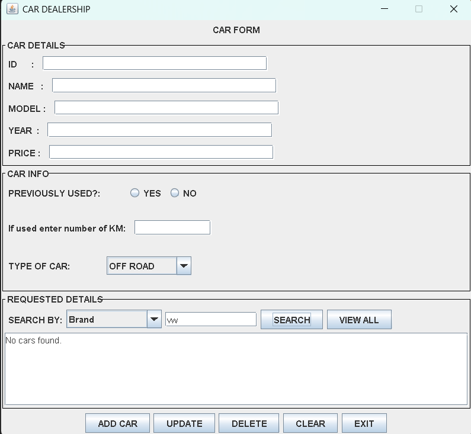

# Car Dealership Management System

A Java Swing desktop application for managing a car dealership's inventory. Vehicles are stored in a local SQLite database using JDBC, so records are kept between sessions.

Built by Shekwa WL, Tshwane University of Technology (TUT).

## Screenshot



## Features

- **Add** a car (brand, model, year, price, previously used, mileage, car type)
- **View all** cars stored in the database (shown automatically on start-up)
- **Search** by:
  - All Vehicles
  - Brand
  - Model
  - Maximum Price
  - Maximum Mileage (used cars only)
  - Car Type
- **Update** an existing car using its ID
- **Delete** a car using its ID (asks for confirmation first)
- **Clear** the form and search fields
- **Input validation** with clear messages:
  - All car details must be completed
  - Year must be valid (1886 up to next year)
  - Price must be greater than zero
  - Mileage is required for used cars and cannot be negative
  - Year, price, KM and ID must be numbers

## How to Use

| Action | Steps |
|--------|-------|
| Add a car | Fill in the details and click **ADD CAR** (leave ID empty, it is assigned automatically) |
| Search | Choose a search type, enter a value, click **SEARCH** |
| View everything | Click **VIEW ALL** |
| Update a car | Enter the car's **ID** (shown in the results), change the details, click **UPDATE** |
| Delete a car | Enter the car's **ID**, click **DELETE**, then confirm |
| Reset the form | Click **CLEAR** |

## Built With

- Java 23
- Java Swing (GUI)
- JDBC with SQLite (`sqlite-jdbc`)
- NetBeans IDE

## Project Structure

```
CarFrameApp/                          Main project (starts the application)
  src/carframeapp/CarFrameApp.java

CarLibrary/                           Library project
  src/za/ac/tut/CarFrame.java         GUI and user interaction
  src/za/ac/tut/CarDatabase.java      Database access (add, view, search, update, delete)

lib/                                  Required jar files
```

## How to Run

1. Clone the repository:
   ```
   git clone https://github.com/MaharajShady/Car-Dealership-Management-System.git
   ```
2. Open both **CarLibrary** and **CarFrameApp** in NetBeans.
3. Add these jars from the `lib/` folder under **Libraries** in both projects:
   - `sqlite-jdbc-3.46.1.0.jar`
   - `slf4j-api-2.0.13.jar`
   - `slf4j-nop-2.0.13.jar`
4. Right-click **CarLibrary** and choose **Clean and Build**.
5. Right-click **CarFrameApp** and choose **Clean and Build**, then **Run**.

The database file `cars.db` is created automatically in the project's working folder the first time the app runs.

## Database

Table `cars`:

| Column   | Type    | Description                  |
|----------|---------|------------------------------|
| id       | INTEGER | Primary key (auto increment) |
| name     | TEXT    | Car brand                    |
| model    | TEXT    | Car model                    |
| year     | INTEGER | Year of the car              |
| price    | REAL    | Price in rand                |
| used     | INTEGER | 1 = used, 0 = new            |
| km       | INTEGER | Kilometres (used cars)       |
| car_type | TEXT    | OFF ROAD, SPORT, SEDAN, SUV, HATCHBACK, CONVERTIBLE, VAN, ELECTRIC or LUXURY |

All database queries use prepared statements.
